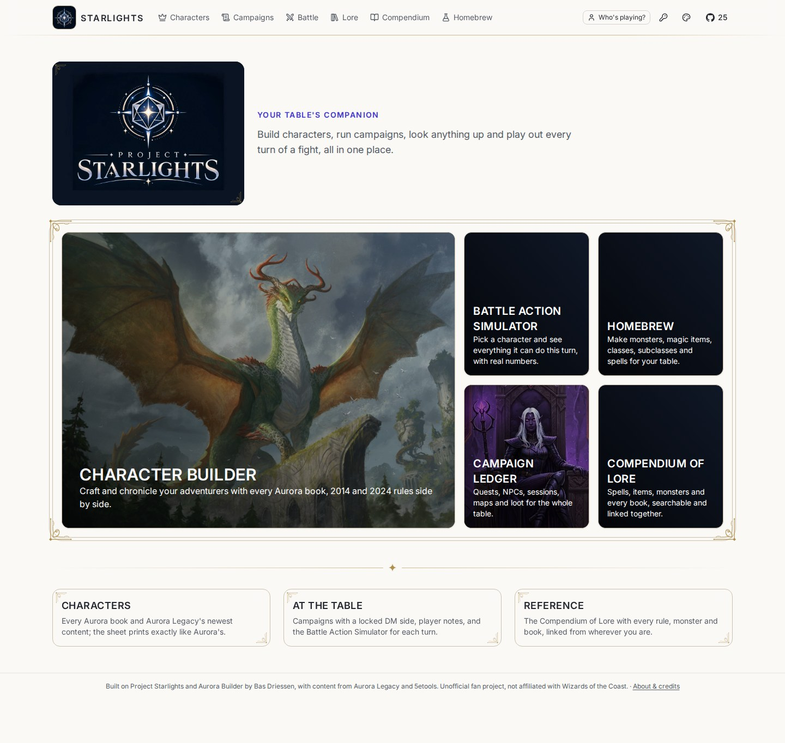
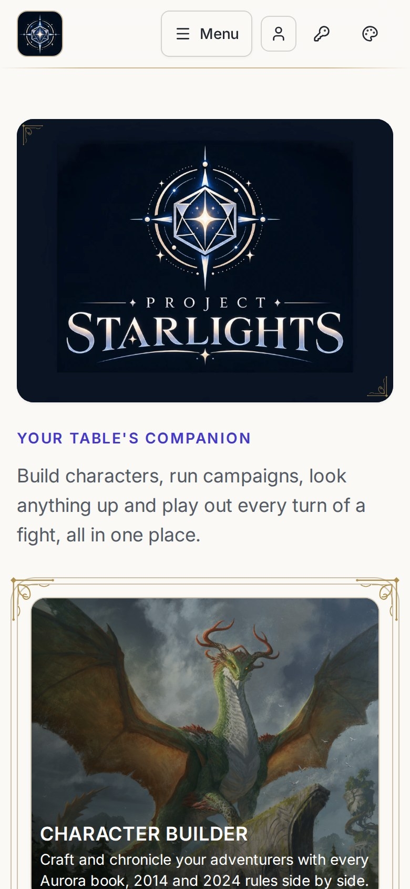

# Project Starlights

> **About this fork (branch `aurora-server`).** A self-hosted build of Project Starlights by C Hassapis, packaged to
> run in Docker for a D&D group. All credit for Starlights and Aurora Builder goes to their creator, **Bas Driessen**
> ([swdriessen/starlights](https://github.com/swdriessen/starlights), [aurorabuilder.com](https://www.aurorabuilder.com)).
> The content comes from [Aurora Legacy](https://github.com/AuroraLegacy/elements) and the Compendium's data from
> [5etools](https://github.com/5etools-mirror-3/5etools-src). Unofficial fan project, not affiliated with or endorsed by
> Wizards of the Coast; no book content is part of this repository. The original README follows the fork's sections.

<p align="center">
  
  &nbsp;
  
</p>
<p align="center"><sub>The home page on a desktop and on a phone (Porcelain theme). A new install shows it like this; the
three plain tiles take pictures you add yourself.</sub></p>

**Contents:** [What this fork adds](#what-this-fork-adds) · [Install](#install-with-docker) ·
[Using it](#using-it) · [Settings](#settings) · [Content](#how-aurora-legacy-and-5etools-are-connected) ·
[Updating](#updating) · [Backups](#backups-and-restoring) · [Playing away from home](#playing-away-from-home) ·
[Troubleshooting](#troubleshooting) · [Removing it](#removing-it) · [Developer API](#developer-api) ·
[Credits](#credits-and-legal)

## What this fork adds

- **Docker install** for one machine: `deploy/setup.sh` sets everything up, and the app downloads its own content.
- **Content page**: paste the GitHub links for Aurora Legacy and 5etools (or your forks) and the server downloads,
  imports and wires everything: the builder's rules, the Compendium of Lore, and every character updated.
- **Character wizard** for new players: class, species, background, ability scores, the books' starting equipment
  (packages or gold) and spells, one step at a time, with a skip to the full builder.
- **Character sheets like Aurora's**, on screen and as PDF, built in (nothing to copy from Aurora), with the portrait
  sized and placed as you like and a last page showing the whole picture; bring in players' Aurora character files.
- **Builder**: multiclassing, 2014 and 2024 rules (or both), Save / Discard, items that cast spells, extra feats,
  languages and proficiencies. Each option in a choice says what it needs ("Artificer Level 6+"); the ones a character
  doesn't qualify for yet are greyed out at the end of the list.
- **Battle Action Simulator**: attacks, spells, slots and charges, familiars, conditions; magic items under the action
  they take (wands and staffs cast, potions, charms with charges), and a potion or healing charm used on another
  party member goes straight into their simulator; prepare spells right there, and cast one the player forgot to
  prepare (the DM's call).
- **Campaigns** with a DM's side: sessions, NPCs, places, quests, maps, handouts, magic items to hand out, notes, and a
  Gold tab with the party fund and stash. The Magic items tab shows who carries each item. Players only see what the
  DM reveals; a Compendium link can stay the DM's alone (the stat block behind an alias). **Export campaign** saves
  all of it as one file.
- **Encounters run as fights**: initiative, turns, monster hit points (hidden from players), and the party's hit points,
  armor class (magic items included), passive Perception and conditions straight from their simulators.
- **Trading**: players give each other items and coins from their Equipment tab.
- **Homebrew page**: make magic items (weapons can have their own damage dice) and monsters in a form, or upload Aurora
  element files. Homebrew is off by default: a player ticks it in a character's Sources, and a DM switches on
  "Use homebrew" in a campaign's settings.
- **Compendium of Lore**: the books, creatures, spells and items from the 5etools data, linkable from campaigns.
- Player names instead of accounts, with optional passwords; an admin password for the DM.

## Install with Docker

The full, step-by-step guide is **[docs/installation.md](docs/installation.md)**; this is the short version.

### What you need

- A computer that stays on while you play: a home server, a spare PC or a NAS that runs Docker.
  - **64-bit Intel/AMD (x86-64) only.** The database (Microsoft SQL Server) has no ARM version: no Raspberry Pi,
    no Windows on ARM.
  - **4 GB of RAM** for Docker (8 GB recommended) and **at least 10 GB free disk** (20 GB recommended).
- **Linux** (Ubuntu or Debian) with Docker Engine and its Compose plugin, or **Windows** with WSL2 and Docker Desktop.
  `git` and `python3` in Linux/WSL. Your user must be able to run `docker info` without sudo.
- An internet connection for the first setup (the Docker images and about 200 MB of content).

### Linux

```bash
cd ~
git clone --branch aurora-server https://github.com/CHassapis/starlights.git
cd starlights/deploy
./setup.sh --check     # checks Docker, memory, disk and the port; changes nothing
./setup.sh
```

### Windows (Docker Desktop + WSL2)

Install WSL2 with Ubuntu and Docker Desktop (WSL2 backend, Linux containers, WSL integration for Ubuntu switched on),
then run the same commands **in the Ubuntu terminal**, with the checkout in your Linux home (`~/starlights`), never on
`C:\` or `/mnt/c`. Open **http://localhost:8093** in your Windows browser. A PowerShell launcher (`deploy/setup.ps1`)
does the same from PowerShell; see [docs/installation.md](docs/installation.md#windows-docker-desktop-and-wsl2).

### What setup does

It checks the prerequisites, writes `deploy/.env` once with random passwords (never printed; your **admin password**
is `STARLIGHTS_MASTER_PASSWORD` in that file), builds and starts the database, API and web app, and has the app
download and import Aurora Legacy and the 5etools data (20–40 minutes the first time). Running `./setup.sh` again
is safe: it never replaces `.env` and never deletes anything in `data/`, including your backups.

Open `http://localhost:8093` on that computer, or `http://<its LAN address>:8093` from phones and other computers at
home. The site restarts by itself after a reboot (on Windows, while Docker Desktop runs).

**Then make your first backup**: `maintenance/backup.sh` (see [Backups and restoring](#backups-and-restoring)).

## Using it

### Players

1. Open the site and **pick your name** (top right). There are no accounts: your characters are filed under your name.
   To stop others changing them, use **Lock your characters** to give your name a password.
2. **Create Character**. Pick the rules (2014, 2024 or both) and leave "Guide me step by step" ticked if you're new:
   the wizard walks through class, species, background, ability scores, the books' starting equipment and spells.
   Experienced players untick it and go straight to the full builder (tabs: Build, Abilities, Magic, Equipment, Story,
   Sources). Already have an Aurora character? Use **Import from Aurora** with its `.dnd5e` file.
3. Changes are kept only when you press **Save** in the bar at the bottom (or **Discard changes** to go back).
4. **Character sheet** shows the sheet and downloads it as a PDF. **Battle** opens the Battle Action Simulator for
   playing: hit points, attacks, spells and slots, conditions, rests.
5. Join your group's campaign with the **Campaigns** button on your character (the DM may give you a password).

### The DM

1. Press the **key button** in the header and enter the admin password. It opens every character and campaign, and
   allows homebrew. (Anyone with it is a DM, so keep it to yourself.)
2. **Campaigns → New campaign.** In **Campaign settings** choose the party, add a cover, set a password for players
   and a DM password (so a co-DM can run it without the admin password), and switch on **Use homebrew** if you want it.
3. Everything you add starts hidden: players see an entry only when you reveal it. Use the **DM / Player** switch at the
   top to check what players see.
4. **Encounters → Run the fight**: add the party and the monsters, roll initiative, track hit points; players follow
   along in their simulators.
5. **Magic items → Give to…** puts an item straight into a character's equipment and notes it in the Gold tab.
6. **Campaign settings → Export campaign** saves the whole campaign as one `.zip` (see below).

### Exporting a campaign

The DM (the campaign's DM password or the admin) can download a campaign as one `.zip` file to keep or read
elsewhere. It holds `campaign.json` and a `pictures/` folder:

| Included | Left out on purpose |
|---|---|
| the campaign's name, description, cover, party, DM name and settings (Use homebrew; whether it has passwords) | the campaign's password, the DM password and players' passwords (no hashes either) |
| every entry as the DM sees it: sessions, codex, quests, maps, handouts, notes, DM notes, links (DM-only ones too) | players' **private** notes (only their authors can read them, not even the DM) |
| the ledger (Gold tab: party fund and stash lines) and the magic items with where each one is | unlock tokens, the admin key and every server setting |
| encounters with their running fights (initiative, monster hit points, conditions) | the books' content (Aurora Legacy, 5etools): ids and links point into it |
| each party member: all of their build (the same capture as the builder's Save/Discard), equipment, spells, story and fight state; who carries which magic item | the build of a character whose player locked it, unless the DM holds that player's unlock token (then only name and player) |
| the books' and homebrew items the campaign's magic items are, by id, name and book | homebrew files themselves (back up `data/homebrew`), other campaigns and characters |
| the campaign's pictures and the party's portraits and story pictures | |

The export holds your DM notes: keep it private. Starlights can't import it yet; it is a readable, complete copy
(`campaign.json` maps each picture to the address the campaign uses). For a full backup of the server, see
[Backups](#backups-and-restoring).

### Homebrew

On the **Homebrew** page (admin password needed) make magic items and monsters with a form, or upload Aurora element
files (`.xml`) for classes, species, backgrounds and anything else. Homebrew starts switched off everywhere:

- a player ticks the homebrew book in their character's **Sources** tab to use it in the builder;
- a DM ticks **Use homebrew** in the campaign settings to hand out homebrew items and add homebrew monsters to fights.

## Settings

The settings live in `deploy/.env` (never share or commit it):

| Setting | What it is |
|---|---|
| `STARLIGHTS_MASTER_PASSWORD` | The admin password (key button). Change it any time, then `docker compose up -d`. |
| `STARLIGHTS_PORT` | The port the site is on (default `8093`). Change it, then `docker compose up -d`. |
| `STARLIGHTS_ADMIN_KEY` | Sent by `./admin.sh` for imports. Any long random text. |
| `STARLIGHTS_SA_PASSWORD` | The database password. Set once by `setup.sh`; **don't change it** after the first start (the database keeps the old one). |

## How Aurora Legacy and 5etools are connected

The app brings in its own content from two GitHub links, kept on its **Content** page (in the top bar once you unlock
admin with the key button):

| Content | Standard link | Used for |
|---|---|---|
| Aurora Legacy | [github.com/AuroraLegacy/elements](https://github.com/AuroraLegacy/elements) | classes, species, backgrounds, feats, spells, items: the builder's rules |
| 5etools | [github.com/5etools-mirror-3/5etools-src](https://github.com/5etools-mirror-3/5etools-src) | the Compendium of Lore, deities and rules Aurora lacks, creatures for encounters, starting equipment |

To use your own fork (or a branch, as `…/tree/branch-name`), paste its link and press **Save and update now**. The
server then:

1. downloads each repository at its newest commit (skipped when nothing changed; for 5etools only its `data` folder);
2. sets up the base rules the first time;
3. imports Aurora Legacy, what 5etools has and Aurora Legacy lacks, and the built-in extras;
4. builds the Compendium of Lore;
5. runs every character through the rules again, so they get new choices.

**When 5etools is ahead of Aurora Legacy.** A new book often reaches 5etools first. Whatever 5etools has and Aurora
Legacy (with its open pull requests and your homebrew) does not (spells, feats, class options such as invocations,
backgrounds, species, subclasses, classes) is translated into Aurora's format and imported with everything else,
marked "Imported automatically from 5etools". What 5etools records as data becomes rules: proficiencies and their
choices, ability scores, prerequisites, spell slots and prepared spells, spells a subclass always has prepared. What it
only describes in words stays words on the sheet. Aurora's version always wins: once Aurora Legacy adds the book, its
own elements are used and the translation stops (a character who already took the translated one keeps it). To turn
this off, set `FiveETools__Generate=false` for the API in `deploy/docker-compose.yml`.

The page also shows where things stand: the **server** (the Starlights version it was built from, whether every
database change is applied, and how many characters, campaigns, elements and homebrew items there are) and the
**content** (Aurora Legacy's commit, the 5etools release, the last update that worked, and whether one is running).
**Check for updates** asks GitHub, only when you press it, what is newer: Aurora Legacy's new commits and the files
they change, 5etools' new release and its notes, and what **Update now** would download. Nothing updates by itself.

Only GitHub links are accepted. The downloads live in `deploy/data/content`, the Compendium in `deploy/data/lore`, and
your homebrew (`deploy/data/homebrew`) is never touched. The character sheet needs nothing extra: its templates and
fonts are part of the app. An optional extra:

- **Background pictures**: put `home-1.webp` … `home-5.webp`, `lore.webp` and `battle.webp` in `deploy/data/art`.

Installed before the sheet was built in? The `deploy/data/aurora-sheets` folder is no longer used and can be deleted.

## Updating

New code, from the `deploy/` folder:

```bash
maintenance/update.sh --check     # what the update brings and whether it changes the database; changes nothing
maintenance/update.sh             # asks, backs up, keeps the running version for a rollback, then updates
```

It refuses to run with local code changes or anything but a straight fast-forward, makes a verified backup first,
builds the new version while the old one keeps running, and afterwards checks that the site works and that no
characters, campaigns, players, portraits or homebrew went missing. If something goes wrong it says exactly how to go
back: `maintenance/rollback.sh <old version>` (program only) or, when the update changed the database, a restore of
the backup it made. Details: [docs/maintenance.md](docs/maintenance.md#updating-to-a-new-version). Don't update with a
bare `git pull` + `docker compose build`: that has no backup and no way back once the database has changed.

Coming from a version before October 2026: this version changes how content is imported (Aurora's appends, what each option needs, and what 5etools has that Aurora Legacy lacks), so import it again once and update the characters, while nobody is using the site: `./admin.sh import AuroraLegacy.index --replace`, then `./admin.sh import homebrew --replace` if you have homebrew, then `./admin.sh import 5etools --replace`, `./admin.sh import starlights --replace` and `./admin.sh reprocess`. Characters keep their picks. Coming from a version before the sheet was built in: nothing is needed from Aurora any more, and the
`deploy/data/aurora-sheets` folder can be deleted.

New content: press **Save and update now** on the Content page, or run `./admin.sh update`. The database changes a new
version needs are applied by themselves when it starts. To get new content every night, add a cron job (`crontab -e`):

```
30 3 * * * cd /path/to/starlights/deploy && ./admin.sh update >> data/update.log 2>&1
```

`./admin.sh` (run it without arguments for help):

| Command | What it does |
|---|---|
| `./admin.sh update [--force]` | the same as the Content page's button: downloads what changed, imports it, rebuilds the Compendium, updates characters (`--force`: everything again) |
| `./admin.sh status` | what the content update is doing or last did |
| `./admin.sh import <index> [--update\|--replace]` | imports one index again: `AuroraLegacy.index`, `5etools`, `starlights` (built-in extras), `homebrew` |
| `./admin.sh reprocess` | runs every character through the rules again |

## Backups and restoring

Your group's data is the database (characters, campaigns, players, imported content and homebrew) and the portraits,
campaign pictures, homebrew files and artwork in `deploy/data`. The downloaded books can always be downloaded again.
From the `deploy/` folder, while the site runs:

```bash
maintenance/backup.sh                      # SQL Server's own backup (checked by SQL Server) + the folders
maintenance/verify.sh --deep               # proof the newest backup restores (in a throwaway database, not your site)
maintenance/restore.sh data/backups/<folder>
```

A backup is a folder in `deploy/data/backups/` that only your user can read: the database backup, the folders, a
manifest of what is in it and checksums. **Copy it to another disk or computer** too. Don't back up by copying
`data/mssql`: SQL Server's files copied while it runs can be broken without anyone noticing.

`restore.sh` replaces what is there now, so it checks the backup fully first, refuses one made by a newer version,
asks you to type the install's name, makes a safety backup of the current state, and moves the current folders aside
instead of deleting them. Moving to a new computer: install there with `setup.sh`, copy the backup folder into its
`deploy/data/backups/`, restore. Everything else (nightly backups, what each message means):
[docs/maintenance.md](docs/maintenance.md).

These scripts are for installs made from `deploy/` (by `setup.sh`). A server set up some other way (the project's
own server is one) needs its own backup routine.

## Playing away from home

Don't open the port on your router: the site serves book content for your table's private use and must not be on the
open internet. To play from anywhere, use a private network such as [Tailscale](https://tailscale.com) (free for
personal use): install it on the server and on each player's device, then open `http://<server's Tailscale name>:8093`.

## Troubleshooting

| Problem | What to do |
|---|---|
| `setup.sh` stops with an error | It names the step and what to do; rerunning it is safe. More in [docs/installation.md](docs/installation.md#timeouts-and-troubleshooting). |
| A backup, restore or update stops | It says why and what to do; nothing was half-done without saying so. See [docs/maintenance.md](docs/maintenance.md#when-something-goes-wrong). |
| "port is already allocated" | Another program uses 8093: set `STARLIGHTS_PORT=8094` (or another) in `.env` and run `docker compose up -d`. |
| The Compendium of Lore says it isn't set up | On the Content page press **Download everything again** (or `./admin.sh update --force`). |
| The content update stopped | The Content page shows the step and the reason. "GitHub did not answer" usually means its limit of 60 checks an hour: try again later. |
| New classes or options don't show after an update | `./admin.sh reprocess` |
| A player forgot their password | Unlock admin with the key button, pick that player's name (top right), and use **Change password** to set a new one or remove it. |
| You forgot the admin password | It's `STARLIGHTS_MASTER_PASSWORD` in `deploy/.env`. |
| Something else | `docker compose ps` shows what is running; `docker compose logs -f` follows the logs. |

## Removing it

First copy anything in `data/backups/` you want to keep somewhere else: the last command deletes it too.

```bash
cd starlights/deploy
docker compose down
docker rmi $(docker compose config --images | grep -v mssql)   # this install's own images
docker run --rm -v "$PWD:/d" alpine rm -rf /d/data     # deletes everything, including characters, campaigns and backups
```

## Developer API

Other programs can read your group's characters from a Starlights server: the web app runs on the same HTTP API.

- **Guide:** [docs/api/README.md](docs/api/README.md): players and passwords (`X-Player-Token`), characters,
  attacks (custom attacks included), inventory, magic and combat, with what the API does not do yet.
- **Description:** [docs/api/openapi.json](docs/api/openapi.json) (OpenAPI 3.1, generated from the endpoints by a test
  that fails when they drift), readable with [docs/api/index.html](docs/api/index.html) (Scalar).
- **Examples:** [Python](docs/api/examples/starlights_client.py) and [TypeScript](docs/api/examples/starlights-client.ts).

Keep the server on your private network; the documentation lives here, not on the server.

## Credits and legal

- [Project Starlights](https://github.com/swdriessen/starlights) and [Aurora Builder](https://www.aurorabuilder.com) by
  **Bas Driessen**: the app, its rules engine and the Aurora way of building characters (MIT licence, kept in
  [LICENSE](./LICENSE)).
- [Aurora Legacy](https://github.com/AuroraLegacy/elements): the community's content files.
- [5etools](https://github.com/5etools-mirror-3/5etools-src): the data behind the Compendium of Lore.
- The PDF sheet: Aurora Builder's sheet templates (their artwork and the Dungeons & Dragons logos belong to their
  owners), and the fonts [Carlito](https://github.com/googlefonts/carlito) and
  Adobe's [Source Sans 3](https://github.com/adobe-fonts/source-sans) (SIL Open Font License); see
  [the sheet's folder](./src/frontend/apps/builder-app/src/assets/sheet/README.md).
- This fork (Docker packaging and the features listed above) by C Hassapis.

Dungeons & Dragons and its books belong to Wizards of the Coast. This is an unofficial fan project, not approved or
endorsed by Wizards of the Coast. No book content is in this repository: `setup.sh` downloads it onto your own machine
for your own table's use.

## The original README

This is a work-in-progress project intended as an online toolset to enhance tabletop role‑playing games. Its initial focus is creating characters for Dungeons & Dragons in the form of an online version of [Aurora](https://www.aurorabuilder.com), which was my original creation years ago.

If you'd like to see this project grow, please consider giving it a star :star: — thank you!

There is no public-facing website hosted for this project at this time, and more details will be shared as development progresses.

<hr />

_A screenshot from the experimental Development UI in this project._


## Running Locally

This project uses .NET Aspire for local orchestration. You can run it using Visual Studio or the command line.

### Prerequisites

- .NET 10 SDK
- Node.js 20.19+
- Docker Desktop (or compatible container runtime)
- Visual Studio (recent version) or Visual Studio Code

### Using Visual Studio

1. Open `Starlights.slnx` in Visual Studio.
2. Ensure `Starlights.AppHost` is set as the startup project with `https` as the launch profile.
3. Press **F5** to start debugging.

Once running, the Aspire Dashboard will launch automatically. From there, you can access the frontend application, backend API, and Scalar API documentation.

### Using Aspire CLI

To run the application using the Aspire CLI (see [aspire.dev](https://aspire.dev)), execute the following command in the root directory:

```bash
aspire run
```

This will start the AppHost, which orchestrates:

- **SQL Server**: A container (port `61070`)
- **Migrations**: Automatically applies EF Core migrations
- **Backend API**: The .NET Web API
- **Frontend**: The React/Vite application
- **Dashboard**: The Aspire dashboard for logs and metrics

### Initial Setup

Before using the application, initialize the sample data. In the Aspire Dashboard, locate the backend API resource and run the database initialization/seed action named **Initialize Database**.

## Running Tests

You can run the automated test suite using Visual Studio or the command line.

### Using Visual Studio 2026

1. Open the **Test Explorer** window (**Test** > **Test Explorer**).
2. Click the **Run All Tests** button (or press **Ctrl+R, A**).

### Using CLI

To run all tests, execute the following command in the root directory:

```bash
dotnet test
```

## Architecture

The project follows a **Modular Monolith** architecture, organized by business capability:

- **Elements Module**: Manages game data (classes, abilities, features, rules).
- **Characters Module**: Handles character creation and management.
- **Platform Layer**: Provides shared infrastructure (hosting, logging, data, eventing).

Each module is self-contained with its own domain logic, data persistence, and API endpoints.

## Acknowledgements

This project builds on my experience developing [Aurora](https://www.aurorabuilder.com), a character builder for Windows.

## License

This project is being developed in the open under the [MIT License](./LICENSE).
